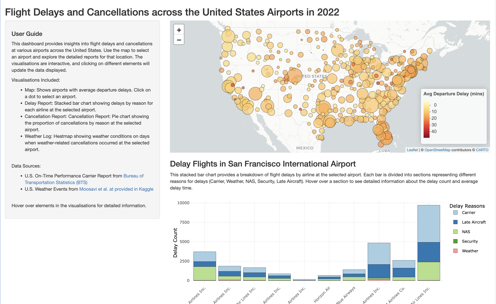
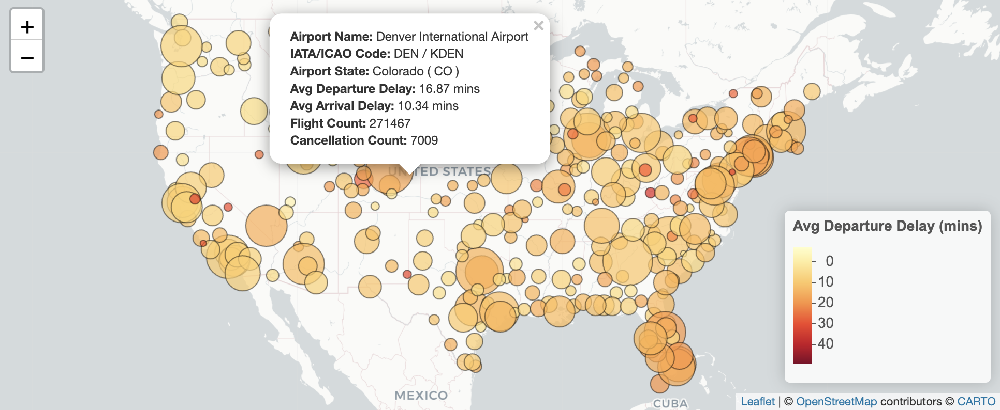
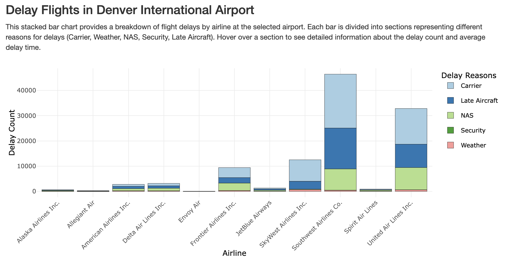
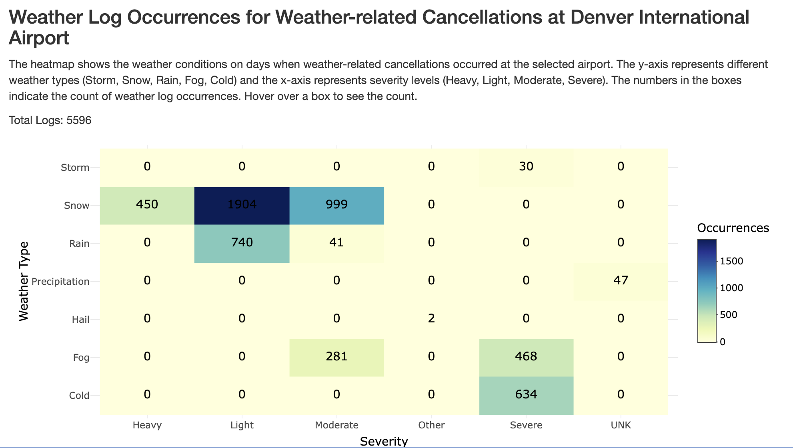

# Flight Delays and Cancellations Across U.S. Airports (2022)

An interactive dashboard that shows where and why U.S. flights were delayed or cancelled in 2022, and how weather relates to cancellations. Built with Python (data wrangling) and R Shiny (dashboard) as part of the Master of Data Science at Monash University.

## Questions the dashboard answers

1. What patterns of delays and cancellations appear across airlines and airports?
2. How do delays vary by airline and airport?
3. What are the common reasons for cancellations, and how do they relate to weather?

## How it works

Click an airport on the map and every other chart updates for that airport.

| Component | What it shows |
|---|---|
| Interactive map (Leaflet) | Every airport as a circle: colour is average departure delay, size is flight count. Click for a summary popup |
| Delay report (stacked bar) | For each airline at the selected airport, the number of delayed flights by cause: Carrier, Weather, NAS (National Aviation System), Security, Late Aircraft |
| Cancellation report (pie) | Share of cancellations by reason: Carrier, Weather, NAS, Security |
| Weather log (heatmap) | Weather type by severity, counted on days when weather-related cancellations occurred at that airport |

## Example: Denver International Airport (default selection)

- 271,467 flights in 2022, average departure delay of 16.87 minutes and average arrival delay of 10.34 minutes
- 7,009 cancellations: 53.4% attributed to weather and 42.6% to the carrier
- On Denver's weather-cancellation days, snow was the most frequently logged condition (for example, 1,904 logs at light severity)

## Data

| Source | Used for |
|---|---|
| [U.S. Bureau of Transportation Statistics, On-Time Performance](https://www.transtats.bts.gov/DL_SelectFields.aspx?gnoyr_VQ=FGJ&QO_fu146_anzr=b0-gvzr) | Flights, airlines, airports, delays and cancellations (about 6 million flight records for 2022) |
| [US Weather Events (Moosavi et al.), Kaggle](https://www.kaggle.com/datasets/sobhanmoosavi/us-weather-events/data) | Weather events from airport weather stations (8.6 million events, 2016 to 2022) |

`flights.csv` and `weather_log.csv` in this repo are the wrangled files the dashboard reads.

## Data wrangling (Python)

Steps are in `wrangling.ipynb`:

- Filtered the flight data to airports covered by the weather dataset, and the weather data to 2022 and to airports present in the flight data
- Matched airport codes across sources (IATA in the flight data, ICAO in the weather data) using an airports reference table, and replaced airline codes with airline names
- Merged flights and weather on airport and date, focusing on weather-related cancellations

## Design

The dashboard was designed with the Five Design Sheet method (brainstorm, three alternative designs, then a final design) for airline operations managers, policymakers and frequent travellers. Colour palettes come from ColorBrewer and are colour-blind friendly.

## Run it locally

1. Install R, then the packages: `install.packages(c("shiny", "leaflet", "dplyr", "htmlwidgets", "ggplot2", "plotly", "tidyr", "RColorBrewer"))`
2. Clone this repo and open R or RStudio in the repo folder, so `flights.csv` and `weather_log.csv` are in the working directory
3. Run `shiny::runApp("app.R")`

## Limitations

- Weather logs show conditions recorded on days with weather-related cancellations. This shows co-occurrence, not proven cause
- Delay counts are flights with a non-zero delay attributed to each cause. A flight with several causes appears under each
- Airports with few flights give small, noisy shares
- Covers 2022 only

## Tools

Python, R, Shiny, Leaflet, ggplot2, Plotly, dplyr, tidyr, RColorBrewer

## Author

Lutfi Muzzaki Khairullah
